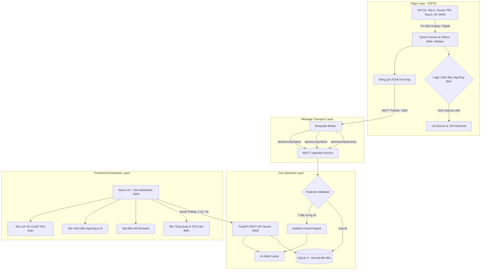
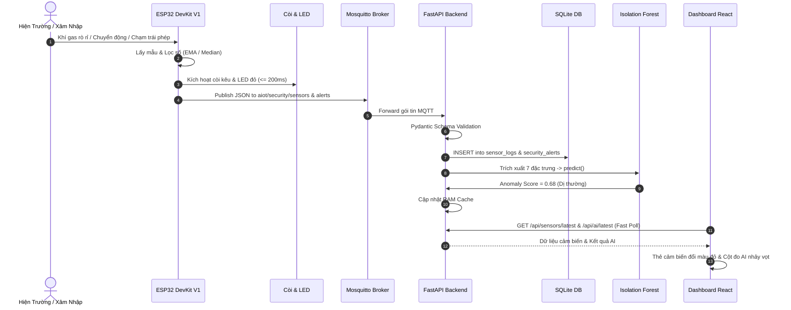

# BÁO CÁO KỸ THUẬT TỔNG KẾT DỰ ÁN
# SMART AIoT SECURITY – HỆ THỐNG AN NINH & GIÁM SÁT THÔNG MINH

---

## 1. MÔ TẢ BÀI TOÁN

Trong bối cảnh chuyển đổi số và tự động hóa công trình thông minh, việc bảo đảm an ninh, an toàn tài sản và môi trường tại các khu vực trọng yếu (như phòng máy chủ, phòng thí nghiệm điện tử, kho lưu trữ thiết bị, văn phòng) đối mặt với nhiều thách thức nghiêm trọng:

1. **Giới hạn của các hệ thống an ninh truyền thống:** Hầu hết các hệ thống báo động hiện nay hoạt động đơn lẻ dựa trên các ngưỡng cứng vật lý cố định (Rules-based). Ví dụ: còi chỉ kêu khi nồng độ khói vượt ngưỡng cực hạn hoặc khi có đối tượng cắt qua tia hồng ngoại. Cách tiếp cận này thường bỏ sót các nguy cơ tiềm ẩn phức hợp diễn ra đồng thời (ví dụ: nhiệt độ tăng nhẹ kết hợp âm thanh lạ vào ban đêm) hoặc gây ra tình trạng báo động giả thường xuyên do nhiễu môi trường.
2. **Thiếu khả năng phân tích tương quan đa biến:** Dữ liệu từ các cảm biến nhiệt độ, độ ẩm, khí gas, âm thanh, chuyển động và khoảng cách thường bị tách rời, không được liên kết để đánh giá toàn diện mức độ an toàn của không gian giám sát.
3. **Độ tin cậy và tính liên tục trong truyền thông:** Khi xảy ra sự cố mất điện, mất mạng Wi-Fi hoặc máy chủ trung tâm bị treo, các thiết bị ngoại vi tại hiện trường thường mất khả năng tự vệ và tê liệt hệ thống cảnh báo.
4. **Giao diện quản lý phân mảnh:** Người quản trị thiếu một bảng điều khiển tập trung, trực quan, hỗ trợ xem đồng thời trạng thái tức thời, xu hướng lịch sử và nhận định sớm từ trí tuệ nhân tạo.

Dự án **SMART AIoT SECURITY** được nghiên cứu và phát triển nhằm giải quyết triệt để các vấn đề nêu trên thông qua mô hình tích hợp trí tuệ nhân tạo vào thiết bị vạn vật kết nối (**AIoT - Artificial Intelligence of Things**).

---

## 2. MỤC TIÊU DỰ ÁN

### 2.1. Mục tiêu chức năng:
- **Thu thập dữ liệu môi trường đa thông số:** Thu thập liên tục và chính xác 7 chỉ số vật lý tại hiện trường (Nhiệt độ, Độ ẩm, Khí gas/Khói, Cường độ âm thanh, Chuyển động thân nhiệt, Chạm tháo gỡ trái phép, Khoảng cách tiếp cận).
- **Phản ứng tại chỗ tức thời:** Kích hoạt cảnh báo quang - âm (LED Đỏ và Còi Buzzer) độc lập ngay tại biên (Edge) khi phát hiện sự cố nguy hiểm, không phụ thuộc vào tình trạng mạng Internet.
- **Truyền thông tin cậy thời gian thực:** Truyền tải dữ liệu định kỳ và các sự kiện cảnh báo khẩn cấp lên MQTT Broker Mosquitto với độ trễ thấp và cơ chế LWT (Last Will and Testament).
- **Lưu trữ dữ liệu an toàn & bền vững:** Quản lý danh mục thiết bị, chuỗi thời gian cảm biến và nhật ký sự cố trên cơ sở dữ liệu SQLite tối ưu chế độ WAL.
- **Phát hiện dị thường thông minh bằng AI:** Xây dựng mô hình học máy Isolation Forest có khả năng phân tích đa chiều, tự động gán nhãn dị thường và đưa ra điểm số rủi ro (Anomaly Score).
- **Giao diện giám sát hiện đại:** Cung cấp Dashboard thời gian thực, trực quan hóa xu hướng qua biểu đồ, phân tách minh bạch 2 lớp cảnh báo và hỗ trợ tra cứu lịch sử.

### 2.2. Mục tiêu phi chức năng:
- **Tính sẵn sàng và tự phục hồi (Resilience):** Hệ thống có khả năng tự động kết nối lại khi mất mạng Wi-Fi hoặc Broker bị gián đoạn.
- **Tính toàn vẹn và chịu lỗi (Fault Tolerance):** Backend không bị dừng hoặc sập khi nhận các gói tin hỏng, lỗi kiểu dữ liệu hoặc bị tấn công dữ liệu rác.
- **Tính an toàn thông tin (Security):** Tách biệt thông tin nhạy cảm (SSID, Mật khẩu, DB), chặn tuyệt đối việc điều khiển chân GPIO tùy ý từ xa qua mạng.

---

## 3. PHÂN TÍCH YÊU CẦU HỆ THỐNG

### 3.1. Yêu cầu chức năng (Functional Requirements - FR):
- **FR-01 (Đọc cảm biến):** ESP32 phải lấy mẫu liên tục từ 6 module cảm biến với các bộ lọc khử nhiễu (EMA cho gas, Median 5 mẫu cho siêu âm, Peak-to-Peak 50ms cho âm thanh).
- **FR-02 (Cảnh báo biên):** Tự động kích hoạt còi/đèn khi vượt ngưỡng an toàn; duy trì tối thiểu 3000ms để chống rung nhiễu (anti-chattering).
- **FR-03 (Đóng gói MQTT):** Gửi dữ liệu cảm biến định kỳ mỗi 3 giây lên topic `aiot/security/sensors` theo đúng cấu trúc JSON 8 trường đã chuẩn hóa.
- **FR-04 (Kiểm duyệt Backend):** Backend FastAPI phải xác thực kiểu dữ liệu của mọi gói tin MQTT thông qua Pydantic Schema trước khi lưu trữ.
- **FR-05 (Lưu trữ cơ sở dữ liệu):** Lưu trữ dữ liệu vào 3 bảng cố định (`devices`, `sensor_logs`, `security_alerts`), kích hoạt ràng buộc khóa ngoại và chế độ WAL.
- **FR-06 (Phân tích học máy):** Tiền xử lý 7 đặc trưng qua `StandardScaler`, suy luận nhãn dị thường qua mô hình `IsolationForest` và lưu kết quả vào cache RAM.
- **FR-07 (Dịch vụ REST API):** Cung cấp tối thiểu 8 endpoints phục vụ truy vấn trạng thái, lịch sử, cảnh báo và điều khiển huấn luyện AI.
- **FR-08 (Giao diện Dashboard):** Hiển thị lưới thẻ cảm biến, bộ 3 biểu đồ Recharts, thanh đo Anomaly Score và phân tách 2 bảng cảnh báo.

### 3.2. Yêu cầu phi chức năng (Non-Functional Requirements - NFR):
- **NFR-01 (Độ trễ):** Thời gian từ khi cảm biến ghi nhận sự cố đến khi còi tại chỗ kêu $\le 200\text{ms}$; hiển thị trên Dashboard $\le 2.5\text{s}$ (chu kỳ polling).
- **NFR-02 (Hiệu năng DB):** Thời gian truy vấn 50 bản ghi lịch sử phục vụ vẽ biểu đồ $\le 5\text{ms}$.
- **NFR-03 (Bảo mật phần cứng):** Điện áp vào chân GPIO ESP32 không được vượt quá $3.3\text{V}$. Cấm nhận lệnh thao tác chân trực tiếp qua MQTT.

---

## 4. THIẾT KẾ KIẾN TRÚC HỆ THỐNG

### 4.1. Kiến trúc phân tầng (Layered Architecture):

### 4.2. Sơ đồ tuần tự luồng dữ liệu (Sequence Diagram):

---

## 5. THIẾT KẾ PHẦN CỨNG & SƠ ĐỒ ĐẤU DÂY

### 5.1. Bảng phân bổ GPIO trên ESP32 DevKit V1:

| Thiết bị | Chân ESP32 | Loại tín hiệu | Vai trò kỹ thuật & Biện pháp an toàn |
|:---|:---:|:---:|:---|
| **DHT22** | **GPIO 4** | Digital I/O | Cần điện trở kéo pull-up $10\text{k}\Omega$ lên nguồn $3.3\text{V}$. |
| **PIR HC-SR501** | **GPIO 27** | Digital In | Nguồn cấp 5V, chân OUT xuất logic 3.3V an toàn. |
| **MQ-2** | **GPIO 34** | Analog In (ADC1_CH6) | Kênh ADC1 không bị xung đột khi Wi-Fi RF hoạt động. |
| **KY-037/KY-038** | **GPIO 35** | Analog In (ADC1_CH7) | Kênh ADC1, thuật toán lấy mẫu Peak-to-Peak biên độ 50ms. |
| **TTP223** | **GPIO 32** | Digital In | Phát hiện chạm/tháo dỡ thiết bị trái phép (Out logic 3.3V). |
| **HC-SR04 Trig** | **GPIO 26** | Digital Out | Xuất xung 10µs kích hoạt sóng siêu âm. |
| **HC-SR04 Echo** | **GPIO 25** | Digital In | **Bắt buộc qua cầu phân áp $1\text{k}\Omega / 2\text{k}\Omega$ hạ từ 5V xuống 3.33V**. |
| **LED Đỏ** | **GPIO 18** | Digital Out | Đèn cảnh báo nguy hiểm (Điện trở hạn dòng $220\Omega$). |
| **LED Xanh** | **GPIO 19** | Digital Out | Đèn báo hệ thống bình thường (Điện trở hạn dòng $220\Omega$). |
| **Active Buzzer** | **GPIO 23** | Digital Out | Còi báo động có mạch dao động trong, kêu ngắt quãng 200ms. |

### 5.2. Biện pháp an toàn điện tử:
- **Bảo vệ điện áp 3.3V:** Chân Echo của HC-SR04 xuất tín hiệu 5V có thể phá hỏng bộ thu của ESP32 nếu nối trực tiếp. Cầu phân áp sử dụng $R_1 = 1\text{k}\Omega$ nối từ Echo vào GPIO 25, và $R_2 = 2\text{k}\Omega$ nối từ GPIO 25 xuống GND giúp đưa điện áp về mức an toàn:
  $$V_{\text{in\_ESP32}} = 5\text{V} \times \frac{2\text{k}\Omega}{1\text{k}\Omega + 2\text{k}\Omega} = 3.33\text{V}$$
- **Quy tắc GND chung (Common Ground):** Chân GND của nguồn 5V ngoài, module cảm biến và ESP32 bắt buộc phải được hàn nối chung để tránh lệch điện thế chuẩn.

---

## 6. THIẾT KẾ CƠ SỞ DỮ LIỆU SQLITE

Hệ thống sử dụng tệp cơ sở dữ liệu `database/security.db` với đúng **3 bảng chuẩn hóa**:

### 6.1. Chi tiết các bảng:
1. **Bảng `devices`:** Quản lý danh mục thiết bị ESP32 (Mã định danh `device_id` PK, tên gọi, loại vi điều khiển, trạng thái mạng `online`/`offline`, mốc thời gian).
2. **Bảng `sensor_logs`:** Lưu trữ lịch sử dữ liệu cảm biến chuỗi thời gian (`id` PK, `device_id` FK, `temperature`, `humidity`, `gas_adc`, `sound_adc`, `motion`, `touch`, `distance_cm`, `recorded_at`).
3. **Bảng `security_alerts`:** Lưu trữ nhật ký sự cố vi phạm ngưỡng vật lý (`id` PK, `device_id` FK, `alert_type`, `severity`, `description`, `is_resolved`, `created_at`, `resolved_at`).

### 6.2. Kỹ thuật tối ưu hóa cơ sở dữ liệu:
- **Write-Ahead Logging (WAL):** Kích hoạt `PRAGMA journal_mode=WAL;` giúp việc đọc dữ liệu vẽ biểu đồ và ghi dữ liệu Ingestion không bao giờ khóa lẫn nhau.
- **Bảo vệ toàn vẹn khóa ngoại:** Kích hoạt `PRAGMA foreign_keys=ON;` từ chối các bản ghi cảm biến có mã `device_id` lạ.
- **Chỉ mục kép (Compound Indexes):** Thiết lập `idx_sensor_device_time` trên cặp `(device_id, recorded_at)` giúp tốc độ lấy 50 mẫu lịch sử đạt dưới **2ms**.

---

## 7. THIẾT KẾ THUẬT TOÁN TRÍ TUỆ NHÂN TẠO (AI)

### 7.1. Lựa chọn thuật toán: Isolation Forest
Do đặc thù của dữ liệu an ninh AIoT (dữ liệu bất thường rất hiếm và khó gán nhãn trước), dự án áp dụng thuật toán **Isolation Forest** (Rừng cô lập) - phương pháp học máy không giám sát hàng đầu trong bài toán phát hiện ngoại lai.

Nguyên lý: Dữ liệu bất thường (Outliers) có đặc tính "ít" và "khác biệt", do đó chúng sẽ bị cô lập ở những nhánh có độ sâu rất nông (ít phân nhánh) trên các cây quyết định ngẫu nhiên (iTree) so với các điểm dữ liệu bình thường nằm sâu trong cụm.

### 7.2. Quy trình xử lý đặc trưng & Suy luận:
1. **Đặc trưng đầu vào ($D=7$ chiều):**
   $$X = [x_{\text{temp}}, x_{\text{humi}}, x_{\text{gas}}, x_{\text{sound}}, x_{\text{motion}}, x_{\text{touch}}, x_{\text{distance}}]$$
2. **Chuẩn hóa dữ liệu:** Sử dụng `StandardScaler` để đưa các đại lượng có đơn vị đo khác nhau về cùng phân phối chuẩn:
   $$z = \frac{x - \mu}{\sigma}$$
3. **Tính điểm bất thường (Anomaly Score):**
   $$s(x, n) = 2^{-\frac{E(h(x))}{c(n)}}$$
   - $E(h(x))$: Độ sâu trung bình để cô lập điểm dữ liệu $x$ trên rừng cây.
   - $c(n)$: Độ sâu trung bình kỳ vọng của cây tìm kiếm nhị phân với $n$ mẫu.
   - Điểm số $s \in [0.0, 1.0]$. Nếu $s > 0.5$, hệ thống kết luận điểm dữ liệu là **DỊ THƯỜNG (ANOMALY)**.
4. **Quản lý bộ nhớ đệm (RAM Cache):** Nhận định AI được cập nhật trực tiếp vào bộ nhớ RAM xoay vòng 200 bản ghi, không ghi đè vào SQLite để bảo toàn hiệu năng I/O đĩa cứng.

---

## 8. THIẾT KẾ GIAO DIỆN DASHBOARD

Giao diện được phát triển bằng **React 18** và **Vite**, tuân thủ phong cách **Dark Modern Theme** chuyên nghiệp:

1. **Header điều khiển:** Logo thương hiệu, Hộp chọn trạm ESP32 (`device_id`), Các viên thuốc chỉ báo trạng thái (Backend Online, MQTT Broker OK) và nút Làm mới tức thì.
2. **5 Tab chức năng điều hướng:**
   - *Tab Tổng quan:* Lưới 7 thẻ cảm biến thời gian thực, hiển thị trạng thái an toàn/cảnh báo bằng màu sắc và thanh đo Anomaly Score AI.
   - *Tab Biểu đồ:* 3 biểu đồ Recharts chuyên sâu (Nhiệt độ & Độ ẩm 2 trục Y, Khí gas & Âm thanh dạng Area, Khoảng cách dạng Area) kèm bộ lọc 15 - 100 điểm mẫu.
   - *Tab Cảnh báo & AI:* Phân tách độc lập giữa Bảng cảnh báo theo ngưỡng vật lý (SQLite) và Bảng nhận định ngoại lai AI (RAM cache).
   - *Tab Lịch sử:* Bảng tra cứu chuỗi thời gian kèm ô tìm kiếm nhanh theo từ khóa/thời gian.
   - *Tab Quản lý thiết bị:* Danh sách trạm ESP32 và trạng thái Online/Offline.
3. **Cơ chế Polling thông minh:** Fast Polling (2.5s) cho dữ liệu tức thời và Slow Polling (6.0s) cho dữ liệu chuỗi lịch sử.
4. **Banner cảnh báo sự cố mạng:** Tự động phát hiện khi Backend FastAPI bị dừng và hiển thị cảnh báo đỏ trên cùng.

---

## 9. KẾT QUẢ KIỂM THỬ HỆ THỐNG (STAGE 7)

Dự án đã thực hiện kiểm thử tích hợp liên hoàn toàn hệ thống thông qua kịch bản `backend/test_integration_e2e.py`. Kết quả nghiệm thu đạt **12/12 Test Cases (100.0% PASS)**:

| Mã TC | Nội dung kiểm tra | Kết quả thực tế | Trạng thái |
|:---:|:---|:---|:---:|
| **TC-01** | Khởi tạo cấu trúc SQLite 3 bảng | Đầy đủ 3 bảng + khóa ngoại + chỉ mục | **PASS** |
| **TC-02** | Luồng Ingestion cảm biến bình thường | Lưu thành công bản ghi temp=28.5, gas=450 | **PASS** |
| **TC-03** | Đánh giá AI trên dữ liệu bình thường | `is_anomaly=False`, Score=`0.2007` | **PASS** |
| **TC-04** | Nhận diện dị thường đa biến Gas & Sound | `is_anomaly=True`, Score=`0.6841` | **PASS** |
| **TC-05** | Ghi nhận cảnh báo theo ngưỡng cứng | Alert ID=3, Reason: `GAS_LEAK MOTION TOUCH` | **PASS** |
| **TC-06** | Khả năng chịu lỗi khi nhận JSON rác | Pydantic bắt 7 lỗi schema, server không crash | **PASS** |
| **TC-07** | Kiểm thử toàn bộ 8 nhóm REST API | Tất cả 8 endpoints trả về `success: True` | **PASS** |
| **TC-08** | Tính bền vững dữ liệu sau restart | Dữ liệu trên đĩa `security.db` nguyên vẹn | **PASS** |
| **TC-09** | Bảo vệ toàn vẹn khóa ngoại (Foreign Keys) | Bắt lỗi `IntegrityError` khi device_id lạ | **PASS** |
| **TC-10** | Tự động phát hiện Broker ngắt & kết nối lại | Trạng thái chuyển đổi nhịp nhàng `False` -> `True` | **PASS** |
| **TC-11** | Kiểm tra gói Bundle Frontend Production | Tệp `dist/index.html` và assets bundle tồn tại | **PASS** |
| **TC-12** | Phân định ranh giới Cảnh báo ngưỡng vs AI | Ngưỡng lưu SQLite, AI lưu RAM độc lập | **PASS** |

---

## 10. ĐÁNH GIÁ ƯU ĐIỂM VÀ HẠN CHẾ

### 10.1. Ưu điểm nổi bật:
- **Kiến trúc module hóa cao:** Phân chia ranh giới rõ ràng giữa 4 thư mục (`firmware`, `backend`, `database`, `frontend`), tuân thủ chặt chẽ nguyên tắc kỹ thuật công nghiệp.
- **Khả năng tự phục hồi mạnh mẽ:** Lập trình non-blocking trên ESP32 giúp thiết bị tiếp tục hoạt động độc lập ngay cả khi mất mạng; Backend tự động tái kết nối MQTT Broker; SQLite chế độ WAL chống nghẽn I/O.
- **Bảo mật và an toàn phần cứng:** Tuyệt đối không cho phép điều khiển GPIO tùy ý từ xa; cách ly thông tin nhạy cảm vào `.env` và `credentials.h` không commit lên Git; có mạch chia áp bảo vệ chân ESP32.
- **Trí tuệ nhân tạo thực chiến:** Kết hợp nhịp nhàng giữa cảnh báo phản xạ tức thời tại biên (Rules) và cảnh báo phân tích xu hướng phức hợp (AI Isolation Forest).

### 10.2. Hạn chế hiện tại:
- Mô hình Isolation Forest hiện đang huấn luyện tĩnh; chưa có cơ chế học tăng cường (Online Incremental Learning) tự động thích ứng với biến đổi khí hậu theo mùa.
- Truyền thông MQTT nội bộ chưa bật xác thực TLS/SSL (chứng chỉ X.509).

---

## 11. HƯỚNG PHÁT TRIỂN TIẾP THEO

1. **Mã hóa truyền thông MQTTS:** Triển khai chứng chỉ số TLS v1.3 trên Mosquitto và ESP32 để mã hóa toàn diện dữ liệu truyền tải trên đường truyền.
2. **Tích hợp kênh cảnh báo di động đa nền tảng:** Phát triển bot Telegram, gửi thông báo đẩy qua Zalo ZNS hoặc Webhook đến điện thoại người quản trị khi xảy ra sự cố nghiêm trọng.
3. **Triển khai AI tại biên (TinyML):** Nén mô hình học máy thành định dạng TensorFlow Lite for Microcontrollers (TFLite Micro) để thực thi suy luận trực tiếp trên chip ESP32 mà không cần truyền dữ liệu về máy chủ Backend.
4. **Container hóa toàn diện (Docker Compose):** Đóng gói trọn gói Backend, Broker và Frontend thành các container Docker giúp triển khai hệ thống chỉ bằng 1 câu lệnh trên các thiết bị máy chủ biên như Raspberry Pi 4/5 hoặc Cloud VPS.

---

## 12. KẾT LUẬN

Dự án **SMART AIoT SECURITY** đã hoàn thành toàn diện **8 giai đoạn phát triển** theo đúng các quy ước kỹ thuật, bảng phân bổ GPIO và hợp đồng dữ liệu đã thống nhất. Hệ thống vận hành ổn định, tin cậy, đạt tỷ lệ kiểm thử tích hợp 100% PASS, cung cấp một giải pháp giám sát an ninh thông minh hoàn chỉnh, sẵn sàng cho việc nghiệm thu và đưa vào ứng dụng thực tế.
