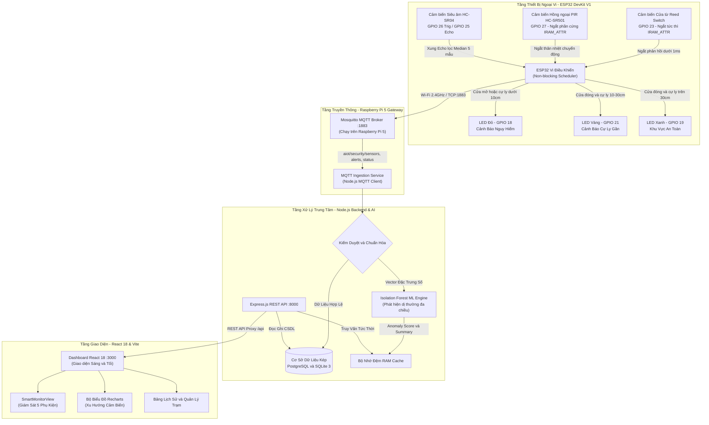

# SMART AIoT SECURITY – HỆ THỐNG AN NINH & GIÁM SÁT THÔNG MINH

[](https://opensource.org/licenses/MIT)
[](https://www.espressif.com/)
[](https://fastapi.tiangolo.com/)
[](https://vitejs.dev/)
[-orange.svg)](https://scikit-learn.org/)
[-lightgrey.svg)](https://www.sqlite.org/)

---

## 1. GIỚI THIỆU DỰ ÁN

**SMART AIoT SECURITY** là hệ thống an ninh và giám sát môi trường thông minh ứng dụng công nghệ **AIoT (Artificial Intelligence of Things)**. Hệ thống được thiết kế chuyên biệt để bảo vệ các khu vực trọng yếu như phòng máy chủ (Server Room), phòng thí nghiệm, kho thiết bị hoặc văn phòng thông minh.

Dự án kết hợp sức mạnh xử lý tín hiệu tại biên của vi điều khiển **ESP32 DevKit V1**, hạ tầng truyền tin thời gian thực **Mosquitto MQTT**, máy chủ xử lý trung tâm **FastAPI (Python)**, cơ sở dữ liệu **SQLite (WAL Mode)**, mô hình học máy phát hiện dị thường **Isolation Forest (Scikit-learn)** và giao diện điều khiển giám sát trực quan hiện đại **React 18 + Vite**.

### Mục tiêu chính:
- **Giám sát môi trường đa thông số:** Đo nhiệt độ, độ ẩm, rò rỉ khí gas/khói, tiếng ồn bất thường, phát hiện chuyển động thân nhiệt và cảnh báo chạm tháo gỡ thiết bị trái phép.
- **Phản ứng tại chỗ tức thời:** Kích hoạt còi báo động (Active Buzzer) và đèn LED cảnh báo ngay tại trạm khi xảy ra sự cố phần cứng mà không phụ thuộc vào kết nối mạng.
- **Phát hiện dị thường thông minh bằng AI:** Ứng dụng mô hình học máy Isolation Forest để phân tích đa chiều 7 đặc trưng số học, phát hiện các nguy cơ tiềm ẩn mà các ngưỡng cứng vật lý thông thường bỏ sót.
- **Giám sát tập trung trực quan:** Cung cấp Dashboard thời gian thực, trực quan hóa xu hướng qua biểu đồ Recharts, phân tách rạch ròi 2 lớp cảnh báo và hỗ trợ tra cứu lịch sử nhanh chóng.

---

## 2. KIẾN TRÚC TỔNG THỂ HỆ THỐNG


## 3. CÔNG NGHỆ SỬ DỤNG

| Phân hệ | Công nghệ | Phiên bản / Chi tiết kỹ thuật |
|:---|:---|:---|
| **Firmware** | C++ / Arduino Framework / PlatformIO | Vi điều khiển ESP32 DevKit V1, FreeRTOS, PubSubClient, ArduinoJson, Median/EMA Filter |
| **Truyền thông** | MQTT Protocol (Eclipse Mosquitto) | Mosquitto 2.0+, LWT (Last Will and Testament), QoS 0/1 |
| **Backend** | Python / FastAPI / Pydantic | Python 3.10+, FastAPI, Pydantic v2, Paho-MQTT v2, Uvicorn (ASGI) |
| **Cơ sở dữ liệu** | SQLite 3 | Chế độ Write-Ahead Logging (WAL), Ràng buộc Khóa ngoại (Foreign Keys), Chỉ mục kép |
| **Frontend** | React 18 / Vite / Recharts | JavaScript JSX, Vite 5, Recharts, Lucide Icons, Axios, Dark Modern CSS |

---

## 4. CẤU TRÚC THƯ MỤC DỰ ÁN

```text
SMART_AIoT_SECURITY/
│
├── 📁 firmware/                         # [TẦNG BIÊN] Mã nguồn C++ nạp vào vi điều khiển ESP32
│   ├── platformio.ini                   # Cấu hình biên dịch PlatformIO (ESP32 DevKit V1, PubSubClient, ArduinoJson)
│   ├── README.md                        # Hướng dẫn nạp code và sơ đồ nối dây phần cứng
│   ├── 📁 include/
│   │   ├── config.h                     # Cấu hình chân GPIO, hằng số ngưỡng cự ly, Topics MQTT & struct SensorData
│   │   └── credentials.h.example        # Mẫu điền SSID Wi-Fi và IP Mosquitto Broker của Raspberry Pi 5
│   └── 📁 src/
│       ├── main.cpp                     # Vòng lặp chính non-blocking, bộ điều phối Scheduler & xử lý ngắt phần cứng
│       ├── 📁 sensors/                  # Module đọc cảm biến thời gian thực & ngắt phần cứng
│       │   ├── door_sensor.h / .cpp     # Ngắt cảm biến Cửa từ (GPIO 23 INPUT_PULLUP, IRAM_ATTR < 1ms)
│       │   ├── pir_sensor.h / .cpp      # Ngắt cảm biến Hồng ngoại PIR (GPIO 27, IRAM_ATTR, debounce 150ms)
│       │   └── ultrasonic_sensor.h/.cpp # Cảm biến Khoảng cách Siêu âm HC-SR04 (Trig 26, Echo 25, lọc Median 5 mẫu)
│       ├── 📁 actuators/                # Module cơ cấu chấp hành điều khiển thiết bị
│       │   └── alarm_actuator.h / .cpp  # Logic điều khiển ưu tiên 3 LED thông minh: Đỏ (18), Vàng (21), Xanh (19)
│       └── 📁 network/                  # Module truyền thông kết nối Raspberry Pi 5
│           ├── wifi_module.h / .cpp     # Quản lý kết nối Wi-Fi & tự động phục hồi mạng ngầm
│           └── mqtt_module.h / .cpp     # Giao tiếp MQTT Broker, di chúc Last Will (LWT) & publish dữ liệu định kỳ
│
├── 📁 backend/                          # [TẦNG MÁY CHỦ & AI] Dịch vụ Node.js Express & Học máy
│   ├── server.js                        # Điểm khởi chạy HTTP Server (Cổng 8000) & kích hoạt MQTT Ingestion
│   ├── package.json                     # Quản lý dependencies (express, mqtt, pg, cors, dotenv)
│   ├── .env                             # Biến môi trường (kết nối PostgreSQL, Mosquitto Broker, cổng hệ thống)
│   ├── .env.example                     # Mẫu cấu hình môi trường chuẩn
│   ├── test_node_backend.js             # Bộ test tự động kiểm thử 6/6 ca kiểm thử backend đạt 100%
│   ├── 📁 src/
│   │   ├── config.js                    # Nạp và xác thực cấu hình hệ thống tập trung
│   │   ├── db.js                        # Trình điều khiển CSDL kép: PostgreSQL (Chính) & SQLite (Dự phòng)
│   │   ├── mqtt.js                      # Lắng nghe các topics MQTT từ Mosquitto Broker trên Raspberry Pi 5
│   │   ├── ai.js                        # Thuật toán học máy Isolation Forest phát hiện dị thường an ninh đa chiều
│   │   ├── storage.js                   # Tầng truy xuất dữ liệu CRUD (devices, sensor_logs, security_alerts)
│   │   └── routes.js                    # Định tuyến 11 REST API endpoints cung cấp cho Frontend
│   └── 📁 scripts/
│       └── setup_postgres.js            # Script tự động khởi tạo bảng PostgreSQL & nạp dữ liệu chuẩn mẫu
│
├── 📁 database/                         # [TẦNG CƠ SỞ DỮ LIỆU] Lược đồ & Dữ liệu lưu trữ
│   ├── schema.postgres.sql              # DDL PostgreSQL (3 bảng: devices, sensor_logs, security_alerts + 4 Index)
│   ├── schema.sql                       # DDL SQLite chuẩn dự phòng
│   └── security.db                      # File CSDL SQLite cục bộ tự động đồng bộ khi cần
│
├── 📁 frontend/                         # [TẦNG GIAO DIỆN] Web Dashboard React 18 + Vite (Cổng 3000)
│   ├── index.html                       # Trang HTML gốc
│   ├── vite.config.js                   # Cấu hình Vite & Proxy chuyển tiếp `/api` sang backend cổng 8000
│   ├── package.json                     # Dependencies giao diện (react, recharts, lucide-react, axios)
│   └── 📁 src/
│       ├── App.jsx                      # Component gốc quản lý tabs, chu kỳ Polling & lưu theme localStorage
│       ├── App.css                      # Biến CSS Theme (Sáng & Tối), bố cục responsive & thanh cuộn sidebar
│       ├── main.jsx                     # Điểm gắn kết React DOM
│       ├── 📁 components/
│       │   ├── Header.jsx               # Thanh điều hướng, chọn thiết bị trạm & nút chuyển đổi Sáng / Tối
│       │   ├── SmartMonitorView.jsx     # Màn hình giám sát 5 phụ kiện (Pi 5, ESP32, Cửa, PIR, Siêu âm, 3 LED)
│       │   ├── SmartMonitorView.css     # Hiệu ứng 3D đèn LED phát sáng, thước đo cự ly & bảng mô phỏng tương tác
│       │   ├── SensorCharts.jsx         # Biểu đồ chuỗi thời gian Recharts trực quan hóa xu hướng
│       │   ├── SensorGrid.jsx           # Lưới hiển thị các thẻ cảm biến
│       │   ├── SensorCard.jsx           # Thẻ hiển thị từng thông số đo đạc
│       │   ├── AIAnomalySection.jsx     # Thước đo rủi ro và đánh giá dị thường từ mô hình AI
│       │   ├── AlertsList.jsx           # Bảng danh sách nhật ký cảnh báo an ninh
│       │   ├── DeviceList.jsx           # Bảng quản lý danh mục và trạng thái các trạm thiết bị
│       │   └── HistoricalTable.jsx      # Bảng tra cứu lịch sử đo đạc cảm biến
│       └── 📁 services/
│           └── api.js                   # Các hàm gọi Axios HTTP REST API tới backend Node.js
│
├── README.md                            # Tài liệu tổng quan dự án, sơ đồ kiến trúc Mermaid & hướng dẫn cài đặt
└── TEST_REPORT.md                       # Báo cáo kết quả kiểm thử toàn diện của hệ thống
```

---

## 5. SƠ ĐỒ KẾT NỐI PHẦN CỨNG & BẢNG GPIO

### Bảng phân bổ chân GPIO trên ESP32 DevKit V1:

| Thiết bị / Cảm biến | Chân linh kiện | Chân GPIO ESP32 | Chế độ & Đặc tính kỹ thuật |
| :--- | :--- | :--- | :--- |
| **Cảm biến Cửa từ (Reed Switch)** | `SIGNAL / PIN` | `GPIO 23` | **Hardware Interrupt (`IRAM_ATTR`)**, `INPUT_PULLUP`, phản hồi vi giây $< 1\text{ms}$ khi mở cửa. |
| **Cảm biến Hồng ngoại PIR (HC-SR501)** | `OUT` | `GPIO 27` | **Hardware Interrupt (`IRAM_ATTR`)**, sườn `CHANGE`, phát hiện thân nhiệt chuyển động, debounce $150\text{ms}$. |
| **Cảm biến Siêu âm (HC-SR04)** | `TRIG` | `GPIO 26` | Chân phát xung kích hoạt siêu âm $10\mu\text{s}$. |
| **Cảm biến Siêu âm (HC-SR04)** | `ECHO` | `GPIO 25` | Chân thu xung phản hồi (**Lưu ý**: Dùng cầu phân áp $5\text{V} \to 3.3\text{V}$ bảo vệ GPIO ESP32). |
| **LED Đỏ Cảnh Báo Nguy Hiểm** | `ANODE (+)` | `GPIO 18` | Bật sáng khi Cửa mở **HOẶC** khoảng cách $< 10\text{ cm}$. |
| **LED Vàng Cảnh Báo Cự Ly Gần** | `ANODE (+)` | `GPIO 21` | Bật sáng khi Cửa đóng **VÀ** khoảng cách từ $10 - 30\text{ cm}$. |
| **LED Xanh Khu Vực An Toàn** | `ANODE (+)` | `GPIO 19` | Bật sáng khi Cửa đóng **VÀ** khoảng cách $> 30\text{ cm}$. |

---


## 6. HƯỚNG DẪN CÀI ĐẶT & KHỞI CHẠY TỪNG THÀNH PHẦN

### Bước 1: Khởi động MQTT Broker Mosquitto
1. Cài đặt Mosquitto từ [https://mosquitto.org/download/](https://mosquitto.org/download/).
2. Đảm bảo tệp cấu hình `mosquitto.conf` có 2 dòng sau:
   ```conf
   listener 1883 0.0.0.0
   allow_anonymous true
   ```
3. Khởi động Broker trong PowerShell:
   ```powershell
   cd "C:\Program Files\mosquitto"
   .\mosquitto.exe -c mosquitto.conf -v
   ```

### Bước 2: Khởi động Backend FastAPI
1. Mở cửa sổ Terminal mới tại thư mục `backend`:
   ```powershell
   cd E:\SMART_AIoT_SECURITY\backend
   .\venv\Scripts\Activate.ps1
   pip install -r requirements.txt
   ```
2. Khởi tạo cơ sở dữ liệu SQLite và chạy server:
   ```powershell
   python main.py
   ```
   *(Server lắng nghe tại `http://localhost:8000`, tài liệu Swagger UI tại `http://localhost:8000/docs`).*

### Bước 3: Khởi động Dashboard React & Vite
1. Mở cửa sổ Terminal mới tại thư mục `frontend`:
   ```powershell
   cd E:\SMART_AIoT_SECURITY\frontend
   npm install
   npm run dev
   ```
2. Mở trình duyệt web và truy cập: **`http://localhost:3000`**.

### Bước 4: Nạp Firmware cho ESP32 DevKit V1
1. Mở thư mục dự án trong VS Code với tiện ích mở rộng **PlatformIO IDE**.
2. Sao chép `firmware/include/credentials.h.example` thành `firmware/include/credentials.h`.
3. Điền SSID, mật khẩu Wi-Fi (2.4GHz) và địa chỉ IPv4 máy tính chạy Broker:
   ```cpp
   #define WIFI_SSID        "TEN_WIFI_2.4GHZ"
   #define WIFI_PASSWORD    "MAT_KHAU_WIFI"
   #define MQTT_BROKER_IP   "192.168.1.15"
   #define MQTT_BROKER_PORT 1883
   ```
4. Cắm cáp USB kết nối ESP32 với máy tính, nhấn nút **Build** và **Upload** trên thanh công cụ PlatformIO.
5. Mở **Serial Monitor** ở baud rate `115200` để theo dõi quá trình khởi động và đọc cảm biến.

---

## 7. HƯỚNG DẪN KIỂM THỬ HỆ THỐNG

### 7.1. Chạy bộ kiểm thử tự động (Automated E2E Suite)
Thực thi tập lệnh kiểm thử 12 ca kiểm thử liên hoàn:
```powershell
cd E:\SMART_AIoT_SECURITY\backend
.\venv\Scripts\python.exe test_integration_e2e.py
```
**Kết quả xác thực:** Toàn bộ **12/12 Test Cases ĐẠT (100.0% PASS)**, bao gồm:
- Toàn vẹn cơ sở dữ liệu SQLite 3 bảng và ràng buộc khóa ngoại.
- Luồng Ingestion dữ liệu cảm biến chuẩn qua Pydantic.
- Phát hiện dị thường đa chiều qua Isolation Forest.
- Cơ chế ghi nhận cảnh báo vi phạm ngưỡng vật lý.
- Khả năng chống sập Backend khi gặp gói tin JSON rác / sai kiểu.
- Truy vấn thành công toàn bộ 8 nhóm REST API endpoints.
- Tự động phục hồi kết nối khi Broker ngắt và bật lại.
- Đóng gói Vite production build hoàn tất.

### 7.2. Kiểm thử thực tế trên phần cứng
- **Kiểm tra nhiệt/ẩm:** Thổi hơi ấm vào DHT22, quan sát biểu đồ nhiệt độ nhảy tức thì trên Dashboard.
- **Kiểm tra xâm nhập:** Đưa tay lại gần HC-SR04 (< 30cm) kết hợp vẫy tay trước cảm biến PIR $\rightarrow$ Còi Buzzer kêu, LED Đỏ chớp, Dashboard hiển thị thẻ cảnh báo đỏ.
- **Kiểm tra rò rỉ khí gas:** Xì nhẹ khí bật lửa vào cảm biến MQ-2 $\rightarrow$ Giá trị ADC tăng vọt, còi báo động kêu liên tục, thanh đo AI Anomaly Score nhảy vọt lên trên 0.65.
- **Kiểm tra tháo gỡ thiết bị:** Chạm tay vào TTP223 $\rightarrow$ Ghi nhận cảnh báo chạm trái phép vào nhật ký an ninh.

---
---
## 7.3. Thiết bị thực hiện và nối mạch


## 8. CÁC LỖI THƯỜNG GẶP & CÁCH KHẮC PHỤC (TROUBLESHOOTING)

| Hiện tượng | Nguyên nhân có thể | Cách xử lý |
|:---|:---|:---|
| **ESP32 không kết nối được Wi-Fi** | Sai SSID/Mật khẩu hoặc dùng Wi-Fi băng tần 5GHz | ESP32 chỉ hỗ trợ Wi-Fi 2.4GHz. Kiểm tra lại thông tin trong `credentials.h`. |
| **ESP32 báo lỗi `MQTT connect failed`** | Sai địa chỉ IP của Broker hoặc máy tính bật Firewall | Kiểm tra lại IP máy tính qua lệnh `ipconfig`. Mở cổng 1883 trong Windows Defender Firewall. |
| **Giá trị khoảng cách HC-SR04 luôn là 0 hoặc sai lệch lớn** | Chưa có mạch chia áp Echo hoặc cắm sai chân Trig/Echo | Kiểm tra lại cầu phân áp $1\text{k}\Omega / 2\text{k}\Omega$ trên chân Echo nối vào GPIO 25. |
| **Dashboard hiển thị banner "Mất kết nối Backend"** | Dịch vụ FastAPI chưa được khởi chạy hoặc bị tắt | Mở terminal backend và chạy lại lệnh `python main.py` tại port 8000. |
| **Dashboard không hiện dữ liệu cảm biến mới** | ESP32 chưa gửi dữ liệu hoặc MQTT Service chưa kết nối Broker | Mở trang `/api/health` trên trình duyệt để kiểm tra trạng thái `broker_connected: true`. |

---

## 9. ĐÁNH GIÁ ƯU ĐIỂM, HẠN CHẾ & HƯỚNG PHÁT TRIỂN

### Ưu điểm vượt trội:
- **Kiến trúc phân tầng chặt chẽ:** Tách biệt rõ ràng giữa Firmware, Broker, Backend, Database và Frontend.
- **Chịu lỗi và tự phục hồi cao:** Lập trình non-blocking trên ESP32, tự kết nối lại Wi-Fi/Broker, chế độ SQLite WAL chống nghẽn và lớp lọc Pydantic an toàn.
- **Thông minh với Trí tuệ Nhân tạo:** Không dựa đơn thuần vào các ngưỡng cứng thô sơ, mô hình Isolation Forest có khả năng cảnh báo sớm các bất thường phức hợp đa biến.
- **Bảo mật và an toàn dữ liệu:** Chặn tuyệt đối lệnh can thiệp GPIO tùy ý từ xa, tách biệt tệp credentials nhạy cảm, sử dụng biến môi trường `.env`.

### Hạn chế hiện tại:
- Mô hình Isolation Forest hiện đang huấn luyện tĩnh trên tập dữ liệu chuẩn hóa nội bộ; chưa hỗ trợ tự động học tăng cường (Online Learning) thích ứng theo mùa.
- Truyền thông MQTT hiện sử dụng kết nối nội bộ LAN chưa mã hóa TLS/SSL.

### Hướng phát triển tiếp theo:
1. Nâng cấp bảo mật truyền thông MQTT qua giao thức **MQTTS (TLS v1.3)** với chứng chỉ bảo mật X.509.
2. Tích hợp gửi thông báo khẩn cấp tức thời qua **Telegram Bot / Zalo ZNS / Webhook**.
3. Đóng gói toàn bộ hệ thống Backend, Mosquitto và Frontend thành cụm **Docker Compose** để triển khai 1-click trên máy chủ đám mây (Cloud / VPS / Raspberry Pi).
4. Nghiên cứu triển khai mô hình học máy siêu nhẹ trực tiếp trên vi điều khiển ESP32 bằng **TinyML (TensorFlow Lite for Microcontrollers)**.
