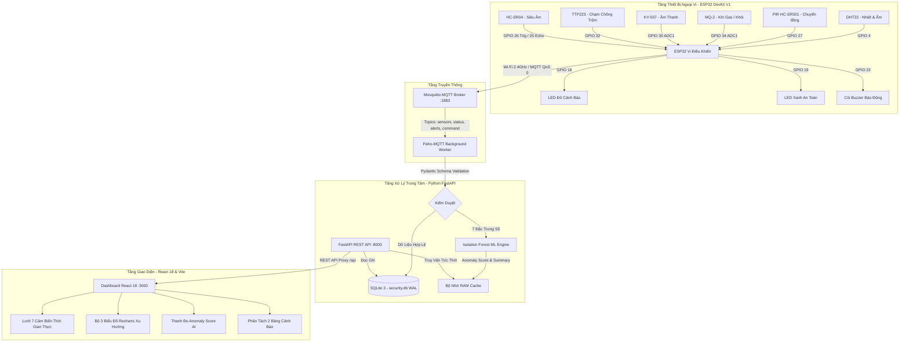

# SMART AIoT SECURITY – HỆ THỐNG AN NINH & GIÁM SÁT THÔNG MINH

[](https://opensource.org/licenses/MIT)
[](https://www.espressif.com/)
[](https://fastapi.tiangolo.com/)
[](https://vitejs.dev/)
[-orange.svg)](https://scikit-learn.org/)
[-lightgrey.svg)](https://www.sqlite.org/)

---

## 1. GIỚI THIỆU DỰ ÁN

**SMART AIoT SECURITY** là hệ thống an ninh và giám sát môi trường thông minh ứng dụng công nghệ **AIoT (Artificial Intelligence of Things)**. Hệ thống được thiết kế chuyên biệt để bảo vệ các khu vực trọng yếu như phòng máy chủ (Server Room), phòng thí nghiệm, kho thiết bị hoặc văn phòng thông minh.

Dự án kết hợp sức mạnh xử lý tín hiệu tại biên của vi điều khiển **ESP32 DevKit V1**, hạ tầng truyền tin thời gian thực **Mosquitto MQTT**, máy chủ xử lý trung tâm **FastAPI (Python)**, cơ sở dữ liệu **SQLite (WAL Mode)**, mô hình học máy phát hiện dị thường **Isolation Forest (Scikit-learn)** và giao diện điều khiển giám sát trực quan hiện đại **React 18 + Vite**.

### Mục tiêu chính:
- **Giám sát môi trường đa thông số:** Đo nhiệt độ, độ ẩm, rò rỉ khí gas/khói, tiếng ồn bất thường, phát hiện chuyển động thân nhiệt và cảnh báo chạm tháo gỡ thiết bị trái phép.
- **Phản ứng tại chỗ tức thời:** Kích hoạt còi báo động (Active Buzzer) và đèn LED cảnh báo ngay tại trạm khi xảy ra sự cố phần cứng mà không phụ thuộc vào kết nối mạng.
- **Phát hiện dị thường thông minh bằng AI:** Ứng dụng mô hình học máy Isolation Forest để phân tích đa chiều 7 đặc trưng số học, phát hiện các nguy cơ tiềm ẩn mà các ngưỡng cứng vật lý thông thường bỏ sót.
- **Giám sát tập trung trực quan:** Cung cấp Dashboard thời gian thực, trực quan hóa xu hướng qua biểu đồ Recharts, phân tách rạch ròi 2 lớp cảnh báo và hỗ trợ tra cứu lịch sử nhanh chóng.

---

## 2. KIẾN TRÚC TỔNG THỂ HỆ THỐNG



---

## 3. CÔNG NGHỆ SỬ DỤNG

| Phân hệ | Công nghệ | Phiên bản / Chi tiết kỹ thuật |
|:---|:---|:---|
| **Firmware** | C++ / Arduino Framework / PlatformIO | Vi điều khiển ESP32 DevKit V1, FreeRTOS, PubSubClient, ArduinoJson, Median/EMA Filter |
| **Truyền thông** | MQTT Protocol (Eclipse Mosquitto) | Mosquitto 2.0+, LWT (Last Will and Testament), QoS 0/1 |
| **Backend** | Python / FastAPI / Pydantic | Python 3.10+, FastAPI, Pydantic v2, Paho-MQTT v2, Uvicorn (ASGI) |
| **Cơ sở dữ liệu** | SQLite 3 | Chế độ Write-Ahead Logging (WAL), Ràng buộc Khóa ngoại (Foreign Keys), Chỉ mục kép |
| **Trí tuệ nhân tạo** | Scikit-learn / NumPy / Pandas | Isolation Forest (100 estimators, contamination 0.05), StandardScaler 7 features |
| **Frontend** | React 18 / Vite / Recharts | JavaScript JSX, Vite 5, Recharts, Lucide Icons, Axios, Dark Modern CSS |

---

## 4. CẤU TRÚC THƯ MỤC DỰ ÁN

```text
E:\SMART_AIoT_SECURITY\
├── README.md                      # Tài liệu tổng thể dự án (Master Guide)
├── PROJECT_REPORT.md              # Báo cáo kỹ thuật tổng kết toàn diện dự án
├── PROJECT_CONTEXT.md             # Tài liệu ngữ cảnh, quy ước phần cứng & dữ liệu
├── PHASE_STATUS.md                # Bảng theo dõi tiến độ và biên bản nghiệm thu 8 giai đoạn
├── CHANGELOG.md                   # Nhật ký lịch sử các phiên bản phát triển
├── TEST_REPORT.md                 # Biên bản kiểm thử tích hợp toàn hệ thống (100% PASS)
├── .gitignore                     # Cấu hình loại trừ tệp nhạy cảm và build
├── .env.example                   # Mẫu cấu hình biến môi trường an toàn
│
├── firmware/                      # Module Firmware vi điều khiển ESP32
│   ├── platformio.ini             # Cấu hình biên dịch PlatformIO
│   ├── README.md                  # Hướng dẫn đấu dây và nạp Firmware
│   ├── include/
│   │   ├── config.h               # Định nghĩa chân GPIO, chu kỳ đọc và ngưỡng
│   │   ├── credentials.h.example  # Mẫu thông tin Wi-Fi và MQTT Broker
│   │   └── credentials.h          # Thông tin mạng thật (không commit Git)
│   └── src/
│       ├── main.cpp               # Điểm khởi chạy non-blocking và xử lý lệnh
│       ├── sensors/               # Drivers đọc và lọc tín hiệu 6 cảm biến
│       ├── actuators/             # Điều khiển còi và LED chống rung nhiễu 3s
│       └── network/               # Module Wi-Fi và MQTT Client tự phục hồi
│
├── backend/                       # Module Máy chủ Backend FastAPI & Dịch vụ AI
│   ├── main.py                    # Điểm khởi chạy FastAPI, cấu hình CORS & Lifespan
│   ├── requirements.txt           # Danh mục thư viện Python cần thiết
│   ├── test_integration_e2e.py    # Bộ kiểm thử tích hợp 12 Test Cases
│   ├── README.md                  # Hướng dẫn cài đặt và tài liệu REST API
│   ├── .env.example               # Mẫu biến môi trường cho Backend
│   └── app/
│       ├── api/endpoints/         # 11 REST API endpoints chuẩn hóa
│       ├── core/config.py         # Quản lý cấu hình tập trung và nạp .env
│       ├── db/session.py          # Kết nối SQLite và thiết lập chế độ WAL
│       ├── models/ & schemas/     # Mô hình dữ liệu và Pydantic Schemas
│       └── services/              # MQTT Ingestion, SQLiteStorage, AI Isolation Forest
│
├── database/                      # Module Cơ sở dữ liệu SQLite
│   ├── schema.sql                 # Kịch bản DDL tạo 3 bảng chính và chỉ mục
│   ├── security.db                # Tệp cơ sở dữ liệu SQLite vật lý
│   └── README.md                  # Hướng dẫn truy vấn, sao lưu và bảo trì DB
│
└── frontend/                      # Module Giao diện người dùng React & Vite
    ├── index.html                 # HTML template gốc
    ├── package.json               # Cấu hình gói và dependencies npm
    ├── vite.config.js             # Cấu hình Vite Dev Server và API Proxy
    ├── README.md                  # Hướng dẫn chạy và sử dụng Dashboard
    └── src/
        ├── App.jsx / App.css      # Điều phối giao diện, Smart Polling, Dark Theme
        ├── services/api.js        # Lớp gọi REST API qua Axios
        └── components/            # 8 Component giao diện chuyên biệt
```

---

## 5. SƠ ĐỒ KẾT NỐI PHẦN CỨNG & BẢNG GPIO

### Bảng phân bổ chân GPIO trên ESP32 DevKit V1:

| Cảm biến / Chấp hành | Chân ESP32 | Mức điện áp | Ghi chú kỹ thuật an toàn |
|:---|:---:|:---:|:---|
| **DHT22** | **GPIO 4** | 3.3V | Cần trở kéo pull-up $10\text{k}\Omega$ lên 3.3V giữa DATA và VCC. |
| **PIR HC-SR501** | **GPIO 27** | 3.3V (VCC 5V) | Cấp nguồn 5V, chân OUT xuất mức 3.3V (an toàn kết nối trực tiếp). |
| **MQ-2 (Khí gas/Khói)** | **GPIO 34** | 0 - 3.3V (ADC1) | Chân Input-Only thuộc ADC1 (hoạt động ổn định khi bật Wi-Fi). |
| **KY-037 (Âm thanh)** | **GPIO 35** | 0 - 3.3V (ADC1) | Chân Analog Out thuộc ADC1, đo biên độ Peak-to-Peak 50ms. |
| **TTP223 (Chạm)** | **GPIO 32** | 3.3V | Cảm biến điện dung chống trộm tháo gỡ thiết bị. |
| **HC-SR04 Trig** | **GPIO 26** | 3.3V | Xuất xung kích hoạt siêu âm 10µs. |
| **HC-SR04 Echo** | **GPIO 25** | 3.3V | **Bắt buộc qua cầu phân áp $1\text{k}\Omega / 2\text{k}\Omega$ từ tín hiệu 5V xuống 3.3V**. |
| **LED Đỏ (Cảnh báo)** | **GPIO 18** | 3.3V | Đèn báo nguy hiểm (Mắc nối tiếp trở hạn dòng $220\Omega - 330\Omega$). |
| **LED Xanh (An toàn)**| **GPIO 19** | 3.3V | Đèn báo bình thường (Mắc nối tiếp trở hạn dòng $220\Omega - 330\Omega$). |
| **Active Buzzer** | **GPIO 23** | 3.3V | Còi báo động (Kêu ngắt quãng 200ms khi có sự cố). |

> [!CAUTION]
> **Quy tắc an toàn phần cứng bắt buộc:**
> 1. Vi điều khiển ESP32 chỉ hoạt động ở mức logic **3.3V**. Không đưa trực tiếp 5V vào bất kỳ chân GPIO nào.
> 2. Chân Echo của HC-SR04 xuất mức 5V, **bắt buộc** phải dùng mạch chia áp:
>    $$\text{V}_{\text{ESP32}} = 5\text{V} \times \frac{2\text{k}\Omega}{1\text{k}\Omega + 2\text{k}\Omega} \approx 3.33\text{V}$$
> 3. Toàn bộ thiết bị (ESP32, cảm biến, còi, nguồn ngoài) phải nối **Chung GND (Common Ground)**.
> 4. Cảm biến MQ-2 cần sấy nóng tối thiểu 15 - 30 phút để giá trị đo đạt độ ổn định.

---

## 6. HƯỚNG DẪN CÀI ĐẶT & KHỞI CHẠY TỪNG THÀNH PHẦN

### Bước 1: Khởi động MQTT Broker Mosquitto
1. Cài đặt Mosquitto từ [https://mosquitto.org/download/](https://mosquitto.org/download/).
2. Đảm bảo tệp cấu hình `mosquitto.conf` có 2 dòng sau:
   ```conf
   listener 1883 0.0.0.0
   allow_anonymous true
   ```
3. Khởi động Broker trong PowerShell:
   ```powershell
   cd "C:\Program Files\mosquitto"
   .\mosquitto.exe -c mosquitto.conf -v
   ```

### Bước 2: Khởi động Backend FastAPI
1. Mở cửa sổ Terminal mới tại thư mục `backend`:
   ```powershell
   cd E:\SMART_AIoT_SECURITY\backend
   .\venv\Scripts\Activate.ps1
   pip install -r requirements.txt
   ```
2. Khởi tạo cơ sở dữ liệu SQLite và chạy server:
   ```powershell
   python main.py
   ```
   *(Server lắng nghe tại `http://localhost:8000`, tài liệu Swagger UI tại `http://localhost:8000/docs`).*

### Bước 3: Khởi động Dashboard React & Vite
1. Mở cửa sổ Terminal mới tại thư mục `frontend`:
   ```powershell
   cd E:\SMART_AIoT_SECURITY\frontend
   npm install
   npm run dev
   ```
2. Mở trình duyệt web và truy cập: **`http://localhost:3000`**.

### Bước 4: Nạp Firmware cho ESP32 DevKit V1
1. Mở thư mục dự án trong VS Code với tiện ích mở rộng **PlatformIO IDE**.
2. Sao chép `firmware/include/credentials.h.example` thành `firmware/include/credentials.h`.
3. Điền SSID, mật khẩu Wi-Fi (2.4GHz) và địa chỉ IPv4 máy tính chạy Broker:
   ```cpp
   #define WIFI_SSID        "TEN_WIFI_2.4GHZ"
   #define WIFI_PASSWORD    "MAT_KHAU_WIFI"
   #define MQTT_BROKER_IP   "192.168.1.15"
   #define MQTT_BROKER_PORT 1883
   ```
4. Cắm cáp USB kết nối ESP32 với máy tính, nhấn nút **Build** và **Upload** trên thanh công cụ PlatformIO.
5. Mở **Serial Monitor** ở baud rate `115200` để theo dõi quá trình khởi động và đọc cảm biến.

---

## 7. HƯỚNG DẪN KIỂM THỬ HỆ THỐNG

### 7.1. Chạy bộ kiểm thử tự động (Automated E2E Suite)
Thực thi tập lệnh kiểm thử 12 ca kiểm thử liên hoàn:
```powershell
cd E:\SMART_AIoT_SECURITY\backend
.\venv\Scripts\python.exe test_integration_e2e.py
```
**Kết quả xác thực:** Toàn bộ **12/12 Test Cases ĐẠT (100.0% PASS)**, bao gồm:
- Toàn vẹn cơ sở dữ liệu SQLite 3 bảng và ràng buộc khóa ngoại.
- Luồng Ingestion dữ liệu cảm biến chuẩn qua Pydantic.
- Phát hiện dị thường đa chiều qua Isolation Forest.
- Cơ chế ghi nhận cảnh báo vi phạm ngưỡng vật lý.
- Khả năng chống sập Backend khi gặp gói tin JSON rác / sai kiểu.
- Truy vấn thành công toàn bộ 8 nhóm REST API endpoints.
- Tự động phục hồi kết nối khi Broker ngắt và bật lại.
- Đóng gói Vite production build hoàn tất.

### 7.2. Kiểm thử thực tế trên phần cứng
- **Kiểm tra nhiệt/ẩm:** Thổi hơi ấm vào DHT22, quan sát biểu đồ nhiệt độ nhảy tức thì trên Dashboard.
- **Kiểm tra xâm nhập:** Đưa tay lại gần HC-SR04 (< 30cm) kết hợp vẫy tay trước cảm biến PIR $\rightarrow$ Còi Buzzer kêu, LED Đỏ chớp, Dashboard hiển thị thẻ cảnh báo đỏ.
- **Kiểm tra rò rỉ khí gas:** Xì nhẹ khí bật lửa vào cảm biến MQ-2 $\rightarrow$ Giá trị ADC tăng vọt, còi báo động kêu liên tục, thanh đo AI Anomaly Score nhảy vọt lên trên 0.65.
- **Kiểm tra tháo gỡ thiết bị:** Chạm tay vào TTP223 $\rightarrow$ Ghi nhận cảnh báo chạm trái phép vào nhật ký an ninh.

---

## 8. CÁC LỖI THƯỜNG GẶP & CÁCH KHẮC PHỤC (TROUBLESHOOTING)

| Hiện tượng | Nguyên nhân có thể | Cách xử lý |
|:---|:---|:---|
| **ESP32 không kết nối được Wi-Fi** | Sai SSID/Mật khẩu hoặc dùng Wi-Fi băng tần 5GHz | ESP32 chỉ hỗ trợ Wi-Fi 2.4GHz. Kiểm tra lại thông tin trong `credentials.h`. |
| **ESP32 báo lỗi `MQTT connect failed`** | Sai địa chỉ IP của Broker hoặc máy tính bật Firewall | Kiểm tra lại IP máy tính qua lệnh `ipconfig`. Mở cổng 1883 trong Windows Defender Firewall. |
| **Giá trị khoảng cách HC-SR04 luôn là 0 hoặc sai lệch lớn** | Chưa có mạch chia áp Echo hoặc cắm sai chân Trig/Echo | Kiểm tra lại cầu phân áp $1\text{k}\Omega / 2\text{k}\Omega$ trên chân Echo nối vào GPIO 25. |
| **Dashboard hiển thị banner "Mất kết nối Backend"** | Dịch vụ FastAPI chưa được khởi chạy hoặc bị tắt | Mở terminal backend và chạy lại lệnh `python main.py` tại port 8000. |
| **Dashboard không hiện dữ liệu cảm biến mới** | ESP32 chưa gửi dữ liệu hoặc MQTT Service chưa kết nối Broker | Mở trang `/api/health` trên trình duyệt để kiểm tra trạng thái `broker_connected: true`. |

---

## 9. ĐÁNH GIÁ ƯU ĐIỂM, HẠN CHẾ & HƯỚNG PHÁT TRIỂN

### Ưu điểm vượt trội:
- **Kiến trúc phân tầng chặt chẽ:** Tách biệt rõ ràng giữa Firmware, Broker, Backend, Database và Frontend.
- **Chịu lỗi và tự phục hồi cao:** Lập trình non-blocking trên ESP32, tự kết nối lại Wi-Fi/Broker, chế độ SQLite WAL chống nghẽn và lớp lọc Pydantic an toàn.
- **Thông minh với Trí tuệ Nhân tạo:** Không dựa đơn thuần vào các ngưỡng cứng thô sơ, mô hình Isolation Forest có khả năng cảnh báo sớm các bất thường phức hợp đa biến.
- **Bảo mật và an toàn dữ liệu:** Chặn tuyệt đối lệnh can thiệp GPIO tùy ý từ xa, tách biệt tệp credentials nhạy cảm, sử dụng biến môi trường `.env`.

### Hạn chế hiện tại:
- Mô hình Isolation Forest hiện đang huấn luyện tĩnh trên tập dữ liệu chuẩn hóa nội bộ; chưa hỗ trợ tự động học tăng cường (Online Learning) thích ứng theo mùa.
- Truyền thông MQTT hiện sử dụng kết nối nội bộ LAN chưa mã hóa TLS/SSL.

### Hướng phát triển tiếp theo:
1. Nâng cấp bảo mật truyền thông MQTT qua giao thức **MQTTS (TLS v1.3)** với chứng chỉ bảo mật X.509.
2. Tích hợp gửi thông báo khẩn cấp tức thời qua **Telegram Bot / Zalo ZNS / Webhook**.
3. Đóng gói toàn bộ hệ thống Backend, Mosquitto và Frontend thành cụm **Docker Compose** để triển khai 1-click trên máy chủ đám mây (Cloud / VPS / Raspberry Pi).
4. Nghiên cứu triển khai mô hình học máy siêu nhẹ trực tiếp trên vi điều khiển ESP32 bằng **TinyML (TensorFlow Lite for Microcontrollers)**.
